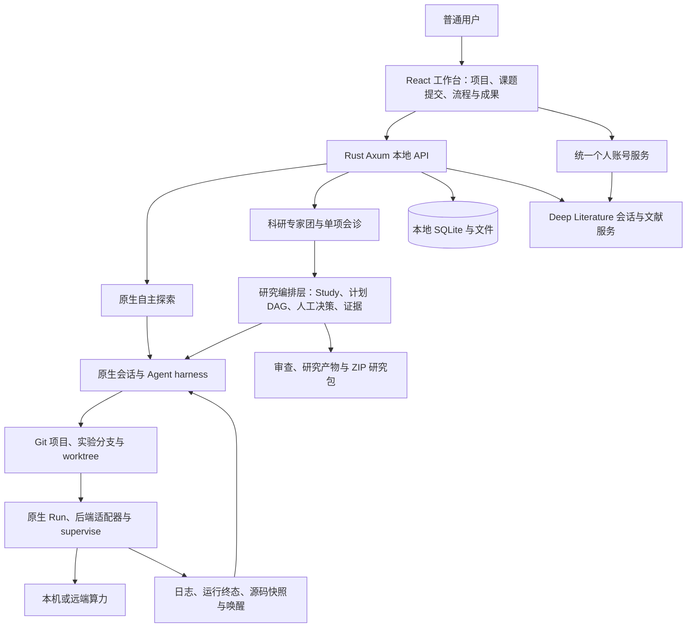
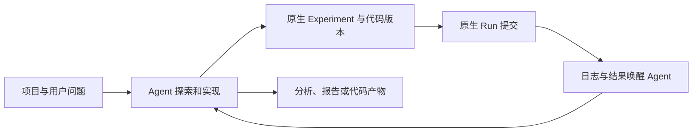

# 当前项目架构与功能设计

整理日期：2026-10-10。依据当前工作区实现；本文描述已实现代码，不等同于生产发布或真实模型端到端验收。详细实现与验证记录见[专家团实现说明](expert-team-implementation.md)。

## 1. 最终融合方案

采用**独立产品入口、可选单项会诊、共享原生执行底座**的方案。

OpenResearch 继续负责项目、会话、代码、实验、算力、日志和运行状态。科研专家团在这些能力之上增加研究目标、版本化计划、专家任务 DAG、人工决策、独立审查和研究包。没有另建一套实验运行引擎，也没有把所有普通会话强制改成专家团。

用户可以选择原生自主探索，或启动完整专家团；已有项目也可以发起方案设计、异常诊断、独立审稿与引用核验。会诊使用同一套研究领域模型，但建立独立研究会话，并限制实验执行权限。

## 2. 总体架构

| 层级 | 职责与边界 |
| --- | --- |
| 产品工作台 | 未登录介绍、项目入口、论文发现、文献阅读、自然语言提交课题、模式识别、流程图、确认和成果下载 |
| 本地 API / CLI | Axum 提供页面接口；`orx` 提供项目、Agent、实验、研究编排命令；前端构建资源保存在 `ui/dist` |
| 研究编排 | 保存 Study、计划版本、专家分工与依赖、授权决策、产物摘要、证据声明；执行派发和验收规则 |
| 原生 Agent 平台 | 支持 Claude Code、Codex、OpenCode、Cursor、Antigravity；复用子会话、消息、队列、worktree 和唤醒机制 |
| 原生实验平台 | Git revision、Experiment、Run、源码快照、后端提交、supervise、日志和取消请求 |
| 本地存储 | SQLite WAL 保存项目和运行事实；文件保存代码、研究产物及日志；专家团与原生流程共享项目数据 |
| 统一账号 | `packages/platform` 提供个人注册、登录、改密、退出及 Deep Literature SSO；平台 PostgreSQL 与本地科研 SQLite 分离 |
| 文献服务 | Deep Literature 独立保存论文、PDF、解读、个人文库和笔记；OpenResearch 读取公开论文字段，统一身份不代表研究证据自动同步 |
| 商业伴随服务 | 外部 `openresearch.sh` 承担组织与托管算力等商业能力；与当前个人产品账号边界分开 |

算力适配包括本地、SSH、Slurm、Kubernetes、Ray、HF Jobs、Modal、Tinker 和 OpenResearch managed compute。适配器存在不代表对应凭据、环境与预算已经配置。工作空间 RBAC、独立执行器等历史兼容能力不属于当前个人版主路径。

## 3. 面向用户的功能设计

### 3.1 提交课题

普通用户只需描述问题，可补充已有材料、期望交付和限制。无需选择专家名单、编写 DAG，或认识 G1–G4、CLI。

示例：

> 我想比较固定学习率和逐步降低学习率，对一个简单预测模型的效果有什么影响。我没有现成数据，希望先用模拟数据，在本机做一个小实验，不使用付费算力。最后请给我结果表和通俗解释，并指出这个实验能说明什么、不能说明什么。

主理人的职责是澄清会影响计划的缺失信息，将课题转成目标、边界、交付物和专家分工。实际派发仍取决于模型执行编排命令和用户确认，提交文本本身不会自动批准实验。

### 3.2 入口与模式

| 模式 | 适用需求 | 执行特点 |
| --- | --- | --- |
| 原生自主探索 | 自由探索、写代码、迭代实验 | 沿用原生 Agent 会话与实验流程，不自动建立专家团 Study |
| 科研专家团 | 从课题到方案、验证、审查和交付 | 主理人组织多个真实专家子会话，以计划 DAG 和人工决策约束执行 |
| 方案设计会诊 | 检查可行性、方法、基线和实验设计 | 独立研究会话；不能配置实验执行专家 |
| 失败异常诊断 | 分析已有失败、日志和异常 | 独立研究会话；当前仍需提供必要材料，未自动完整携带所选 Run 上下文 |
| 独立审稿与引用核验 | 审查结论、论证和引用 | 独立研究会话；必须包含独立审稿和引用审计任务，不能运行实验 |

已有普通会话不会原地自动升级为专家团。由会诊入口创建同项目的新研究会话，保留原来的探索路径。

### 3.3 会诊模块的三层展示

三个会诊入口均提供模块预览，明确用途、所需材料、交付物、四个典型子流程及候选专家；独立审稿和引用审计标为审稿模块必需专家，其余按需安排。候选名单不是固定调度模板，不产生任务或派发记录。

进入研究流程窗口后，通过三个按钮切换：

1. **模块预览**：查看通常怎么做、可能需要哪些专家，始终明确预览与真实安排的区别。
2. **本次分工**：读取最新登记计划，展示每个任务的专家、职责、前置任务、交付要求和计划说明；列出预览中本次未安排的候选专家，省略原因以计划说明为准，界面不自动推断。
3. **实际执行与成果**：依据真实会话绑定统计已派发任务，依据任务验收统计成果，展示实际 DAG、状态、产物与 Run；可从任务详情进入专家子会话。派发不等于模型成功执行或成果已验收。

无计划时展示明确空状态。已有普通会话可先展开会诊模块介绍，再点击开始，不必先创建会诊才能了解内容。完整专家团也复用三层窗口，第一层显示完整研究旅程。

### 3.4 用户如何理解流程

首页和新建会话入口展示完整流程预览，并明确标注“尚未开始”。选择专家团后默认展开，课题示例只填入空输入框，不自动提交。

这 7 个环节是阅读导航，并非另一套强制串行调度器。文献、代码和方法任务可并行；不需要实验时跳过实验授权和执行。

右侧工作区提供小人图标的“科研专家团”入口；展开时显示名称和当前状态，收起时保留图标。点击直接打开专用 DAG 全景窗口，采用 App-CMCC 的纵向分层、专家头像和圆角节点设计；20 位专家完整保留，已安排角色叠加当前计划状态。可切换到本次任务的真实依赖图，定位当前节点，点击查看会话与产物；分工及人工确认通过次级入口查看。普通会话或新建状态也能浏览全景，明确标为能力预览。

研究开始后，界面常驻模式名称、当前环节、待处理事项和当前计划的任务验收进度。完整流程窗口提供阶段概览、实际任务 DAG、任务列表及详情。节点展示专家职责、状态、依赖、产物和关联 Run，支持缩放、平移和选择；当前不支持拖拽编辑计划。计划尚未登记时不生成虚构任务节点。

## 4. 原有流程与专家团流程如何衔接

### 4.1 原生自主探索

原生流程侧重 Agent 持续探索与实验迭代。科研专家团的新增检查仅约束研究绑定会话及其相关运行，不要求所有普通实验经过专家团审批。

### 4.2 专家团完整闭环

1. 用户创建专家团会话，本地同时创建关联项目和主理人会话的 Study。
2. 主理人登记版本化计划，包含任务、专家角色、依赖和预期文件；系统检查 DAG 合法性。
3. 用户确认研究范围 G1；满足前置任务与产物检查后，主理人派发专家任务。
4. 每个任务绑定原生 helper 子会话，继承 harness / 模型并使用原生工作区机制；角色材料与研究上下文按回合注入。
5. 若需实验，准备与原生 Experiment 绑定的运行契约，固定代码 revision、命令和资源参数，取得 G2 / G3 确认。
6. 实验执行专家通过原生运行入口提交 Run。提交前及事务内校验授权、身份、版本和重复消费，随后进入原有后端与 supervise 链路。
7. 专家读取实际结果，提交产物与证据；系统核验文件及摘要、任务关联和真实 Run 终态。
8. 独立审稿在研究产出之后执行，引用审计依赖审稿，归档任务依赖审计。当前完整专家团计划必须包含独立审稿与引用审计。
9. 当前成果和证据通过交付范围检查后，用户确认 G4，再下载批准研究包；也可以导出明确标识的草稿包。

融合点在步骤 4–7：专家团负责“谁做、先后顺序、何时可执行、证据如何验收”，原生平台负责“会话怎么运行、代码怎样隔离、实验怎样提交与追踪”。

## 5. 借鉴 App-CMCC 的内容及适配

| 来源能力 | 当前处理 |
| --- | --- |
| 专家角色职责 | 适配 20 个角色参考材料，按课题选用，不要求每次启动全部专家 |
| 主理人组织与分工 | 通过 `orx research` 编排计划、派发和验收，落到真实原生子会话 |
| 专家 DAG 视觉 | 借鉴专家卡片、方向连线、状态高亮和点击详情；使用本项目已有 React Flow 实现依赖分层及并行分支 |
| 应用专属编排外壳 | 未整体移植 App-CMCC 的应用框架；将任务绑定到 OpenResearch 的项目、会话、实验和 Run |
| 审查和交付 | 增加持久决策、版本和产物摘要检查、实验日志证据与可导出研究包 |

20 个角色覆盖需求识别、资产审计、研究规划、文献策略与发现、论文证据、可行性、方法设计、实验设计、代码工程、实验执行与诊断、结果分析、综合、论证大纲、证据写作、图表引用、独立审稿、引用审计及归档。角色是专业职责约束；是否得到高质量科研结果仍取决于模型、输入材料和审查质量。

## 6. 数据模型与事实来源

| 对象 | 保存什么 | 与原生对象的关系 |
| --- | --- | --- |
| Project | 项目及 Git 仓库 | 两种流程共用 |
| Study | 目标、模式、状态、计划历史、决策与证据 | 关联 Project 和一个主理人 ChatSession |
| ResearchPlan | 版本、摘要、任务 DAG | 不替代 Git revision 或实验分支 |
| ResearchTask | 角色、依赖、预期产物、状态、会话、运行契约 | 派发后绑定原生 helper 会话，实验任务关联原生 Experiment / Run |
| HumanDecision | 确认项、版本、范围摘要、状态、理由和时间 | 持久化在本地研究记录中 |
| Artifact | 路径、文件大小与 SHA-256 | 验收时检查文件，派发依赖任务及交付时再次核验 |
| EvidenceClaim | 声明、证据类别、来源位置或 Run 日志引用 | 实验声明关联真实 Run、commit、日志范围与摘要 |
| Experiment / Run | 实验方向、执行参数、版本、运行状态和日志 | 原生存储继续作为执行事实来源，不新增第二套 Run 表 |

新增 SQLite 表为 `research_studies`、`research_sessions` 和 `research_experiments`。Study 文档保存研究聚合状态，关联表保存会话及实验与任务、计划版本的映射；关键变更使用写事务，保证授权消费与 Run 登记一致。

研究产物放在本地数据库目录下的 `files/<project.slug>/research/<study.id>`；代码继续由原生项目和 worktree 管理。

## 7. 人工确认与执行约束

| 确认项 | 用户确认内容 | 实现约束 |
| --- | --- | --- |
| G1 研究范围与目标 | 研究边界、目标和计划 | 未确认不能派发；新计划版本不能继承旧版本确认 |
| G2 资源与权限 | 运行资源及相关配置 | 与具体运行契约绑定，不是全局永久算力授权 |
| G3 实验方案与执行 | 实验、revision、命令和参数 | 正确任务及专家会话才能提交；一个执行任务最多授权一个 Run |
| G4 研究包交付 | 当前产物、审查和运行证据 | 校验当前范围摘要；证据或文件变化不能沿用原交付确认 |

确认由页面接口持久化，CLI 不提供批准命令；页面请求要求同源浏览器元数据并沿用应用访问控制。决定写入后会尝试唤醒主理人，唤醒失败不回滚决定。

当前为个人本地工作台，审批身份记录为 `dashboard-user`，没有多人强身份审批隔离。G2 是明确运行配置的确认门禁，不是计费预算执行器，也不能阻止具备本机权限的外部进程绕过应用运行。

修改计划需要没有活动研究任务、相关活动运行和原生活动 helper，避免一边执行一边重写依赖。停止研究会阻止后续派发、取消待执行或执行中任务并请求停止 Run / 中断 helper；取消请求不等于远端任务已经终止。

## 8. 证据与研究包

证据区分论文、实验和推断。论文声明要求出处位置；实验声明必须关联同项目真实终态 Run，提取实际日志范围并记录摘要及 commit。实验失败也可能成为负面结果证据，不能把“失败”直接当作无价值研究。

研究包包含 manifest、Study / 计划 / 决策 / 声明、当前计划已验收产物、关联原生日志和冻结源码快照。历史计划元数据保留，不自动打包其全部产物文件。源码按摘要去重；单文件上限 32 MiB，累计内容上限 128 MiB。大型外部数据集记录来源、版本和复现方法，不自动归档。

文件非空、摘要一致和引用可追踪是工程校验，不等于结论科学正确；当前也未自动核验论文原文真伪、指标统计有效性或完整实验可复现性。Deep Literature 的个人笔记、论文正文与本地 Study 证据尚未自动形成双向同步。

G4 通过表示当前研究包交付获得确认，Study 不会自动变为一个独立的 completed 状态；当前顶层状态为 active / stopped，界面阶段完成与任务完成另外计算。

## 9. 关键代码导航

| 文件 / 目录 | 职责 |
| --- | --- |
| `src/store/research.rs` | 研究数据模型、DAG、计划版本、授权、依赖、验收与证据规则 |
| `src/local/research.rs` | 角色材料、每轮上下文、运行契约、研究包导出 |
| `src/commands/research.rs` | status、roles、plan、dispatch、prepare-run、finish、claim、package 命令 |
| `src/commands/up/research.rs` | Study 查询、人工确认、停止与导出 API |
| `src/commands/agent.rs` | 研究任务与原生 helper 会话的原子绑定 |
| `src/compute.rs` | 原生 Run 提交前门禁、配置检查与事务内重复提交防护 |
| `src/local/chat/mod.rs` | 每轮注入研究上下文 |
| `agent-skills/orx-research-team/` | 主理人技能与 20 个角色材料 |
| `ui/src/components/ResearchModePicker.tsx` | 自然语言输入引导、模式选择及预览 |
| `ui/src/components/ResearchJourneyIntro.tsx` | 首页与新建入口共享的 7 环节流程预览 |
| `ui/src/components/ResearchPanel.tsx` | 常驻模式、实时摘要及人工确认入口 |
| `ui/src/components/ResearchWorkflow.tsx` | 实际 DAG、阶段导航、详情、列表及研究操作 |
| `ui/src/research.ts` | 阶段映射、当前版本决策、任务状态与 DAG 布局 |

## 10. 当前完成度和下一步

代码已覆盖独立专家团 / 会诊入口、自然语言引导、版本计划、真实子会话绑定、依赖派发、运行门禁、人工确认、证据验收、独立审查、研究包及流程可视化。

验证记录：Rust 完整测试 1,082 通过、3 忽略；研究相关测试 31 通过；clippy / fmt / debug build 通过。最新 UI 233 项测试、typecheck、样式检查和构建通过，已更新 `ui/dist`。实际 CPU CLI 验证覆盖未授权拒绝、授权后的原生 Run 及重复提交拒绝，但审批和成员绑定使用测试夹具。

**尚未完成真实模型专家团与浏览器交互的端到端验收，也未执行本次发布及跨平台 CI。** 当前应称为“实现完成、可评审，现场闭环待验收”，不能称为已经生产验证。

后续优先验证普通用户从提交课题到批准研究包的完整 CPU 小实验；再完善 Run 会诊材料自动携带、文献证据关联与同步、预算控制，以及多人审批隔离。部署与启动方法见[启动与部署](startup-and-deployment.md)。
