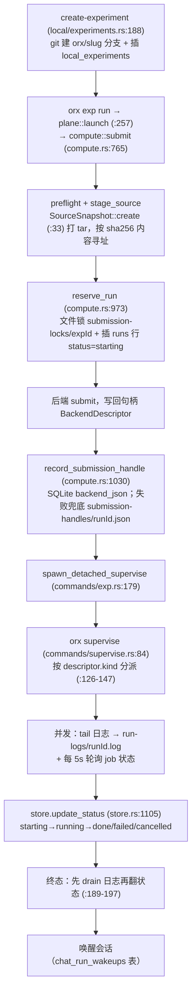

# OpenResearch (`orx`) 从零到一学习指南

> 面向"第一次接触本仓库、希望完整读懂并最终能改动它"的人。
> 每个阶段给出：**读什么 → 跑什么 → 自测什么**。所有引用为 `路径:行号`，可直接跳转。
>
> 本指南基于对工作区代码的直接阅读（非文档转述）。标注 ✅ 的结论已逐行核对；
> 少量 ⚠️ 标注为推断，请自行验证。

---

## 第 0 步：先建立三个心智模型

在读任何代码之前先接受下面三句话，它们能解释本仓库 80% 的设计决策。

### 模型 1：`orx` 是"本地优先的科研代理宿主机"，不是科研算法库

`orx` 自己不训练模型、不做统计。它做四件事：

1. 拉起你机器上**已有的**编码代理（Claude Code / Codex / OpenCode / Cursor / Antigravity）；
2. 把这些代理的一轮轮对话、工具调用、权限审批，变成可持久化、可回放的数据；
3. 让代理能**真正提交实验任务**（本地或远端），并把日志、退出码、产物回灌给代理；
4. 用一个本地网页把这一切显示出来。

所以代码里最多的是：进程管理、事件流解析、SQLite、HTTP 路由。**不是**科学计算。

### 模型 2：三条边界必须是硬的

理解了这三条，目录结构就不再是随机的：

| 边界 | 含义 | 代码证据 |
|---|---|---|
| **研究数据永远本地** | 项目/实验/运行/日志/产物绝不上传 | `src/client.rs:1950-1968` 有一个**读自己源码的测试**，断言生产代码里不许出现 `"/projects`、`"/experiments`、`"/runs`、`"/skills` ✅ |
| **远程服务只管账号与算力** | `client.rs` 只对接 `/orgs`、`/compute/catalog`、`/sandboxes`、`/ssh-keys`、`/feedback` | `src/client.rs:354-413` ✅ |
| **原生对象是唯一事实来源** | 后加的研究编排层**不新建** Run/Experiment 表，只引用原生的 | `src/store/research.rs:1-3`；`docs/ai-for-science/final-architecture-and-functional-design.md:159` |

第 3 条尤其重要：**"要不要新加一张表"的争论，答案通常是不加。**

### 模型 3：这是上游的 fork，读代码前先分清"谁写的" ✅

```jsonc
// product-upstream.json
{ "repository": "https://github.com/alphaXiv/OpenResearch",
  "tag": "v0.2.18", "commit": "0d3d376...", "updateChannel": "product-disabled" }
```

`git diff 0d3d376..HEAD`：**248 个文件，+17408 / −2132，35 个提交全是自研改动** ✅。

- **上游原生**：CLI 骨架、`up` 服务、`store.rs`、harness 适配、jobs 后端、UI 主体、除 `orx-research-team` 外的所有 `agent-skills/`。注释是英文，风格统一且极详尽。
- **本分支自研**：`research` 命令族、`store/research.rs`、`local/research.rs`、`agent-skills/orx-research-team/`、`ui/src/product/`、`packages/platform/`、`scripts/deploy/`、Deep Literature 集成、MobileSci 品牌。

> 判断方法：`git log --oneline` 里中文提交 = 自研；英文提交 = 上游同步。
> 最明显的代码标记：自研模块里 `src/commands/research.rs` 是**唯一用中文报错**的命令模块。

---

## 全局地图

### 三个进程、三个端口 ✅

| 服务 | 端口 | 代码位置 | 职责 |
|---|---|---|---|
| OpenResearch 工作台 | `127.0.0.1:4791` | 本仓库 `src/commands/up.rs` | 项目、会话、实验、Run、研究编排 |
| 账号服务 | `127.0.0.1:5300` | `packages/platform/`（Node + PostgreSQL） | 注册/登录/改密/SSO |
| Deep Literature 文献服务 | `127.0.0.1:3000` | 独立仓库 `../DeepLiterature` | 论文库、PDF、解读、笔记 |

三者**不共享数据库**：本地 SQLite 存研究事实，平台 PostgreSQL 存账号，文献库存论文。
统一登录只解决身份，**不代表研究数据同步**。

### 目录 → 职责

```
src/
├── main.rs              clap 命令树 + dispatch（唯一真相）
├── commands/            每个子命令一个模块
│   ├── up.rs            本地 axum 服务（9503 行，142 条路由）
│   ├── up/              3 个子模块：compute_settings / harness_setup / research
│   ├── exp.rs           单实验生命周期（status/run/cancel/wake/wait/archive）
│   ├── supervise.rs     单个 Run 的守护进程
│   ├── serve.rs         回环 HTTP+SSE 守护（供 agent 盒子隧道）
│   └── *_gate.rs        plan / invocation / mcp 三个隐藏钩子
├── store.rs             SQLite：schema、迁移、全部 CRUD（5734 行）
├── store/research.rs    研究编排持久化（1193 行，JSON 文档式）
├── local/               本地执行平面
│   ├── harness/         5 个代理适配器 + Harness trait
│   ├── chat/mod.rs      会话与回合驱动（11563 行，全仓库最大）
│   ├── experiments.rs   实验节点（slug/branch/row）
│   ├── localrun.rs      本机执行 run
│   ├── research.rs      专家角色材料 + 运行契约
│   └── git.rs           仓库/分支/worktree
├── jobs/                9 个算力后端的提交细节（无 trait）
├── compute.rs           ★ 后端统一 trait + Run 提交门禁 + 去重
├── plane.rs/plane/      本地 CLI 命令平面门面（不是网络层）
├── client.rs            远程 API 客户端（账号+算力+公开文献）
└── telemetry.rs         遥测 + settings.json 的唯一写入者
ui/src/                  React 19 + TanStack Router 前端（6.1 万行）
agent-skills/            15 个代理技能包（含 20 人专家团角色）
docs/ai-for-science/     自研体系设计文档
scripts/                 开发/部署/校验脚本
```

> ⚠️ **一个重要纠正**：执行后端的统一抽象在 **`src/compute.rs:284` 的 `trait ComputeBackend`**，
> **不在 `src/jobs/`**。`jobs/*` 里是各后端的提交细节，内部靠 `descriptor.kind` 字符串分派，
> 没有 `trait Job`。初学者几乎都会在这里找错地方。

### 链路一：一次对话请求 ✅

```
浏览器 → POST /api/chat/sessions/{id}/message        up.rs:773 → send_chat_message:7914
      → ChatHost::send_message                        local/chat/mod.rs:4518
      → 抢占回合槽（TurnState::Reserved，跨进程租约）    chat/mod.rs:2539
      → launch_turn_ctx_locked：tokio::spawn 后台任务  chat/mod.rs:5714
      → HTTP 立即返回 turn_id（不阻塞）
      → 按 harness id 选中 Harness 实现                 harness/mod.rs:522 → :603
      → harness.run_turn(&mut ctx)                    chat/mod.rs:5755
      → 拉起代理子进程，原生事件规范化为 WirePart
      → upsert_part + 75ms 节流 flush                  chat/mod.rs:7662 / :35
      → emit_event → broadcast                        chat/mod.rs:3630
      → forward_chat_events → SSE                     up.rs:8300
      → ui/src/events.ts 唯一 EventSource → ChatPanel 重渲染
```

代理进程的生命周期各不相同（**这是最容易踩空的地方**）：

| 代理 | 进程模型 | 位置 |
|---|---|---|
| Claude Code | **常驻** `claude --print --input-format stream-json` | `harness/claude.rs:329-335`，宿主 `local/claude.rs` + reaper |
| Codex | **常驻** `codex app-server` JSON-RPC | `local/codex.rs:667` |
| OpenCode | **每会话一个** `opencode serve`，随机 loopback 端口 | `local/opencode.rs:439,467` |

**代理全部懒启动**（`up.rs:104-105`），并按内存/空闲时间**回收**（`local/agent_lifecycle.rs:1-25`），
下条消息靠 native session resume 重连。**改 turn 流程时绝不能假设进程常驻。**

### 链路二：一个实验从创建到出结果 ✅



**快照契约（最重要的概念）** ✅ —— `local/localrun.rs:1-6`：

> 每个 Run 都把**记录的 revision** 抽取到**自己的 run 目录**里执行，
> **绝不在代理的 worktree 里跑**。

这条保证"代理一边改代码、实验一边跑"不会互相污染。所有后端都遵守它。
`SourceSnapshot`（`compute.rs:25`）用内容寻址的 tar，让所有后端**免于 clone git 历史**。

---

## 分阶段学习路线

> 节奏建议：阶段 0–2 一天，3–5 两天，6–8 三天，9 半天。

### 阶段 0 · 环境与"活系统"（约 1 小时）

**目标**：能编译、能跑起来、能看懂系统当前状态。

```sh
cargo build --locked                      # 首次慢；已有 target/debug/orx 可跳过
./target/debug/orx --help
./target/debug/orx version
node scripts/dev-slot.mjs start --db empty   # 隔离开发实例（推荐）
node scripts/dev-slot.mjs status
```

**开发隔离的 slot 惯例**：后端 4901 / UI 5201，真实端口以 `status` 输出为准。

> ⚠️ **不要对已有研究数据的环境用 `--db empty`**，也不要用生产库做测试数据。

**读**：`README.md`、`AGENTS.md`、`Cargo.toml`（注释本身就是设计文档）、`docs/ai-for-science/README.md`。

**自测**
1. `orx up` 默认监听什么？`dev-slot.mjs` 的 slot 端口惯例？
2. 为什么 `Cargo.toml` 选 `rusqlite` 的 `bundled` 与 rustls 而不是 native-tls？
   （提示：静态 musl 构建不能依赖系统 OpenSSL 与系统 SQLite）

---

### 阶段 1 · CLI 骨架与命令分发（半天）

**目标**：掌握"一个命令从输入到执行"的全过程。

**读，按此顺序** ✅
1. `src/main.rs:39-185` — `Cli` 与 `Command` 枚举。**唯一真相**。
2. `src/main.rs:1254-1330` — `dispatch()`，纯 match 转发，无业务逻辑。
   注意 `command_uses_lifecycle_lock` 是**反向白名单**（不持有锁的才是例外）。
3. `src/commands/mod.rs:1-17` — 约定：唯一签名 `pub async fn run(args: crate::<Args>) -> Result<()>`。
4. `src/error.rs` — 错误与退出码词汇表。
5. `src/store.rs:25-42` + `src/config.rs:97-160` — 凭据与数据目录落在哪。
6. 一条竖切：`commands/projects.rs` → `plane.rs` → `store.rs`。
7. 最复杂的单命令：`src/commands/exp.rs`。

**命令 → 实现映射**（节选）

| 命令 | 实现 | 职责 |
|---|---|---|
| `login`/`logout` | `commands/login.rs:24` | 回环 OAuth 换 PAT，0600 落盘 |
| `projects`/`project` | `projects.rs:7` / `project.rs:11` | 本地项目；写经 `plane::resolve_project` |
| `runs`/`logs` | `runs.rs:9` / `logs.rs:70` | 运行表格；日志只给路径+字节数+末 500 字符 |
| `create-experiment` | `create_experiment.rs:16` | 造实验节点 |
| `exp` | `exp.rs:20` | 生命周期；`wait`（`:134`）分电平/边沿触发 |
| `compute`/`instance` | `compute.rs:12` / `instance.rs:20` | 算力目录；instance 直连远程 API |
| `discover`/`paper` | `discover.rs` / `paper.rs` | 文献检索取文，公开 API 无 token |
| `serve`/`supervise` | `serve.rs:28` / `supervise.rs` | 回环 HTTP+SSE；单 run 守护 |
| `up`/`up --remote` | `up.rs` / `up_remote.rs` | 本地仪表盘；SSH 隧道 |
| `research` | `research.rs:56` | 研究编排 G1–G4，`require_lead` 校验主理人 |

`app` **不是子命令**：桌面 GUI 在解析 CLI 之前就劫持了（`main.rs:953-968`）。

**关键机制** ✅
- **退出码有四套约定**：clap 解析失败 → 2（`main.rs:47-48` 正为绕开它才把 `command` 设为 `Option`）；
  业务错误 → stderr 后 `exit(1)`；`require_credentials()` **不返回 Result 而直接 `exit(1)`**（`error.rs:30-41`）；
  `plan-gate` **必须永远退 0**（`main.rs:1000`）。
- **数据目录四级优先级**（`store.rs:25-42`）：`$ORX_DATA_DIR` → `settings.json` 的 `dataDir` →
  `$XDG_DATA_HOME/openresearch` → `~/.local/share/openresearch`。
  **真源在 `store.rs`，不是 `paths.rs`**（后者只管 Windows `\\?\` 前缀剥离与 Linux `(deleted)` 后缀修复）。
- **`settings.json` 只有 `telemetry.rs` 能写**（单写者 + 持锁 + 原子 RMW），`config.rs:258-296` 只是转发。
- **`net.rs:5` 的 `loopback_client()` 强制 `no_proxy()`**，否则本地请求会被 `HTTP_PROXY` 劫持（OR-352）。
  `clippy.toml` 用 `disallowed-methods` 禁止别处构造 reqwest client。

**三个隐藏门禁**（`main.rs:992-1026`，抢在 update-check 与 telemetry 之前执行）✅

| 门禁 | 作用 | 失败姿态 |
|---|---|---|
| `plan-gate` | Claude 计划模式的 `PreToolUse` 钩子。**只允许白名单**，未知即视为写操作拦截 | **必须永远退 0**，否则每次 Bash 调用都失败 |
| `invocation-gate` | 改写 `tool_input.command`，注入 `ORX_INVOCATION_CONTEXT` 记录"哪个模型哪次调用发起 run" | **失败即放行**（丢归属只是少信息） |
| `mcp-gate` | 手写 stdio JSON-RPC MCP server，把审批请求中继到 `orx up` 弹卡片 | **绝不挂起、绝不误放行**，缺环境变量即非零退出 |

> `mcp-gate` 的 **stdout 是 MCP 专用通道，不得写任何其他内容**。

**自测**
1. 新增 `orx foo` 子命令，最少要改哪几处？（见练习 2）
2. 裸执行 `orx`（不带子命令）会发生什么？为什么要这样设计？
3. `src/main.rs:6` 的注释说六个 fs 动词路由到 `commands::fs`——对吗？

> 答案 3：**错的，这是失效注释**。全仓库只有这一处提及，`commands/mod.rs` 里不存在 `fs` 模块 ✅。

---

### 阶段 2 · 存储层与数据模型（一天）

**目标**：看到 UI 上任何一个数字，都知道它来自哪张表。

**读** ✅
1. `src/store.rs:442-940` — `open_at_with_move_lock`，含**全部 DDL、ALTER 列表、迁移**。
2. `src/store.rs:25-51` — 数据目录 + 生命周期锁。
3. `src/store/research.rs:341-350` — 自研的三张研究表。

**数据库基础事实** ✅
- 位置：`<data_dir>/orx.db`，WAL + `busy_timeout 5000`。
- **零 FOREIGN KEY**（全仓库 `FOREIGN KEY` 出现 0 次），关系全靠应用层约定，删除靠手写清理 + 触发器。
- **迁移不是版本化框架**：`PRAGMA user_version` 只有一个值 `1`（用于把 `chat_messages` 从线性链回填成树，
  `store.rs:735-768`）。其余全靠：
  (a) `ALTER TABLE ADD COLUMN` 列表，重跑报 duplicate column 即视为成功（`store.rs:670-719`）；
  (b) 幂等 `UPDATE` 做数据归一；(c) 触发器。
- **只有 4 个普通索引** + research 的一个。
- **日志和产物都不入库**：日志是纯文件 `run-logs/<runId>.log`（`store.rs:217-224`），
  产物是磁盘目录 `<data_dir>/files/<slug>`。

**核心表**

| 表 | 作用 | 关键字段 |
|---|---|---|
| `local_projects` | 项目（根实体） | `slug` UNIQUE、`repo_path`、`baseline_branch`、`run_command`、`workspace_state_json` |
| `local_experiments` | 实验节点（一个变更方向） | `project_id`、`parent_experiment_id`（自引用成树）、`branch_name`（`orx/<slug>`）、`UNIQUE(project_id,slug)` |
| `runs` | 一次执行 | `status`、`backend_json`（序列化句柄）、`exit_code`、`cancel_requested`、`chat_session_id` |
| `chat_sessions` | 会话 | `harness`、`native_session_id`、`active_leaf_id`、`parent_session_id`、`goal`、`autonomy` |
| `chat_messages` | **消息树**（可分支） | `parts_json`、`parent_id`、`base/result_native_session_id` |
| `chat_turns` | 幂等回合 | `UNIQUE(session_id, client_turn_id)`、`state`、`attempt_count`、`next_retry_at` |
| `chat_queued_messages` / `chat_run_wakeups` / `chat_spawns` / `chat_turn_leases` | 队列 / 唤醒 / 子代理 / 租约 | 租约含 `claim_token` + 60s TTL |
| telemetry 组（7 张） | run 遥测、原生用量账本、chat 用量采样、待发外箱 | 主键多为 `(harness, scope)` / `(execution_id, sample_id)` |
| `research_studies` | 研究聚合根 | **整个 Study 存成一个 JSON `document`** |
| `research_sessions` / `research_experiments` | 会话/实验 ↔ 任务映射 | `task_id`、`version` |

> 设计要点：研究层刻意用"一个 JSON 聚合 + 两张映射表"，而不是展开成十几张关系表。
> 因为核心承诺是**原生对象（chat/experiment/run）才是事实来源**，研究层只是编排视图。

**跑**

```sh
sqlite3 ~/.local/share/openresearch/orx.db ".tables"
sqlite3 ~/.local/share/openresearch/orx.db "select id,slug,repo_path from local_projects;"
sqlite3 ~/.local/share/openresearch/orx.db "pragma user_version;"
```

**自测**
1. 一个 Run 的执行参数存在哪？`backend_json` 为什么必须是固定字段列表？
2. 为什么 Study 用 JSON 文档存，而不是拆表？
3. 删掉一个项目，它的 Run 会自动消失吗？

> 答案 3：**不会自动级联**。没有外键，靠 `delete_local_project` 手写清理 + 触发器；
> `runs` 残留行是已知形态。

---

### 阶段 3 · 本地服务与 API（一天）

**目标**：能按需定位任意前端功能对应的后端处理函数。

**读** ✅
1. `src/commands/up.rs:1-11` — 文件头注释，三句话讲清三种 surface。
2. `src/commands/up.rs:56-200` — 启动流程（端口绑定、`actual_port` 回填给 chat 供 mcp-gate 用）。
3. `src/commands/up.rs:504-800` — **路由表（142 条）**。不要线性读，用 `grep '\.route('` 检索。
4. `src/commands/up.rs:8286` 附近 — SSE 事件循环。
5. `src/commands/up.rs:8536` — `#[derive(RustEmbed)] #[folder = "ui/dist"]`。

**三种 surface**（`up.rs:3-6`）

| 路径 | 内容 |
|---|---|
| `/` | 内嵌 SPA。**release 编译期内嵌；debug 构建从磁盘读** |
| `/api/*` | 本地 SQLite + 日志文件的 JSON |
| `/api/events` | SSE：500ms 轮询 store 与日志文件做 diff |

**路由分层**（`up.rs:855`）：`DefaultBodyLimit 64MB` → `track_active` → `loopback_guard`；
`--remote` 时再加 `require_remote_auth` + `remote_route_forbidden` 黑名单。

值得先看的几组路由：
- 项目/实验/Run：`/api/projects*`、`/api/experiments/*`、`/api/runs*`
- 会话：`/api/chat/sessions/{id}/message`（`up.rs:773`）、`/interrupt`、`/fork`、`/branch`
- 研究编排：`/api/research/sessions/{id}`、`/api/research/studies/{id}/decisions/{decision}`
- 文献代理：`/api/papers/*`、`/api/deep-literature/*`（浏览器跨域取不到，故由后端代理）
- 设置与后端：`/api/settings/*`、`/api/compute/backends`、`/api/harnesses*`

**关键机制** ✅
- **SSE 是 edge-only，没有 replay**：chat 事件不带快照，断线重连会丢帧。
  服务端在 broadcast `Lagged` 时补发 `resync.required`，UI 收到 `reconnected` 语义必须**重新拉取**。
- **每次 flush 重发整条 assistant 消息**（不是增量），所以有 `TOOL_TEXT_CAP = 16_000` 截断。
  新增 part 类型时务必考虑帧体积。
- **本地 API 默认无鉴权**（仅 loopback）。**唯一例外** `/api/internal/permissions` 要求 spawn 时铸造的
  gate token —— 因为它**授予工具权限**。
- **`ui/dist` 是提交物**（286 个文件已被 git 跟踪）。改前端必须 `pnpm build` 并提交。
  debug 构建读磁盘所以本地看着是新的，**容易误判 release 里的 UI 版本**。

**跑**

```sh
curl -s http://127.0.0.1:4791/api/health
curl -s http://127.0.0.1:4791/api/projects | head -c 400
curl -sN http://127.0.0.1:4791/api/events | head -20     # SSE，Ctrl-C 退出
```

**自测**
1. `/api/events` 为什么用 500ms 轮询 diff 而不是推送？
2. 新增一个只读 API 需要同步改哪些地方？（除 `up.rs`，还要想 `plan_gate.rs` 的白名单）

---

### 阶段 4 · 代理适配层 `Harness`（一天）

**目标**：理解 5 个不同的编码代理如何被抹平成同一套接口。

**读** ✅
1. `src/local/harness/mod.rs:1-18`（能力模型说明）与 `:265-530`（trait + 注册表）。**最关键**。
2. `src/local/harness/plan_gate.rs` — 计划模式的白名单分类。
3. 挑一个实现精读：`claude.rs`（最完整）或 `codex.rs`（最复杂）。

**trait 的设计要点**

| 方法 | 作用 |
|---|---|
| `id()` / `name()` | 线上与库里的稳定标识（如 `"claude-code"`） |
| `supports_chat()` | 是否出现在会话选择器 |
| `detect()` | 完整探测（安装/授权/模型目录）——**慢**，会拉起子进程 |
| `detect_snapshot()` | **快速首遍**，只查文件系统与环境；模型目录延后到后台补 |
| `run_turn()` | 跑一个回合，把原生事件流解析成 `WirePart` |
| `resume_from_prompt` / `ResumeAction` | 抹平两种审批语义："结束本轮再 resume" vs "活进程内联回答" |

> 设计精华：`detect_snapshot` 的存在是因为冷启动 `/api/harnesses` 会被模型目录探测拖慢数秒。
> 已安装但目录未就绪的 harness 会被标 `catalog_pending` 并**先压低就绪度**。
> 这种"先给乐观但受限的答案，再后台补全"的模式在本仓库反复出现。

**跑**

```sh
./target/debug/orx install-skills        # 把 orx 技能装进本机各代理
curl -s http://127.0.0.1:4791/api/harnesses | head -c 600
```

**自测**
1. 加一个新代理（比如 Aider）要新建什么、改哪里？
2. 为什么 `detect` 和 `detect_snapshot` 要分开？

---

### 阶段 5 · 会话与回合驱动（一到两天）

**目标**：读懂全仓库最大的文件 `src/local/chat/mod.rs`（11563 行）。

**策略：不要线性读。** 按下面的线索检索：
1. 先读文件头注释（`mod.rs:1-9`）把握流程。
2. 沿"一条消息的生命周期"追：`send_chat_message`（`up.rs:7914`）→ `ChatHost::send_message`（`chat/mod.rs:4518`）
   → `send_message_showing`（`:2666`，`TurnAdmission::QueueIfBusy`）→ `launch_turn_ctx_locked`（`:5714`）
   → `run_turn`（`:5755`）→ `upsert_part`（`:7662`）→ `emit_event`（`:3630`）。

**必须搞懂的三个机制**
- **回合租约**（`chat_turn_leases` 表 + `TurnState::Reserved`）：防止两个请求同时驱动一个会话，
  含**跨进程 durable lease**（60s TTL）。
- **待处理队列**（`chat_queued_messages` 表）：回合运行中用户又发消息时排队，回合结束后 `drain_queue`。
- **Run 唤醒**（`chat_run_wakeups` 表）：Run 终态时把"实验跑完了"作为一条**持久消息**回灌给代理。
  这是"代理能自主迭代实验"的核心闭环。

**关键类型**

| 类型 | 位置 | 说明 |
|---|---|---|
| `ChatHost` | `chat/mod.rs:2339` | 中枢：turns / queued / gate_tokens / pending_permissions（大量细粒度锁） |
| `TurnCtx` | `chat/mod.rs:7012` | 单回合状态 + 适配器写入点 |
| `WirePart` / `WireMessage` / `WirePrompt` | `chat/mod.rs:836` / `:1084` / `:770` | 与前端共享的规范化 part 协议 |
| `TurnState` / `TurnAdmission` / `TurnSubmission` / `DeliveryState` | `:2539` / `:2666` / `:2702` / `:2739` | 回合状态机与准入语义 |

**自测**
1. 用户在一个正在运行的回合里又发一条消息，会发生什么？
2. 一个实验跑完了，代理怎么知道？**跨进程吗**？
3. 为什么每次 flush 要重发整条消息而不是增量？

---

### 阶段 6 · 实验与执行后端（一到两天）

**目标**：掌握"从 `orx exp run` 到远端任务真的在跑"的全链路。

**读，按此顺序** ✅
1. `src/store.rs:442-940`（若阶段 2 已读可跳）→ 2. `src/jobs/mod.rs:1-70`（`BackendDescriptor` 契约）
→ 3. `src/compute.rs:281-352`（**`trait ComputeBackend`**）与 `:426-690`（注册表）
→ 4. `src/commands/supervise.rs:84-225`（统一监督循环）
→ 5. `src/local/localrun.rs`（最短的完整提交路径）
→ 6. `src/jobs/localbox.rs` → `src/jobs/ssh.rs`（被 slurm/openresearch 复用的传输层）
→ 7. `src/local/experiments.rs`。

**核心抽象** ✅

```rust
// src/compute.rs:284
trait ComputeBackend {
    fn capabilities() -> Capabilities;   // id/label/remote/flavors/requires_flavor/source_transport
    fn preflight(...) -> Preflight;      // 就绪与凭据检查
    fn stage_source(...);                // 快照上传
    fn submit(...) -> ...;               // 提交
    // 默认实现：status / logs / cancel / cleanup
}
```

9 个实现由 `backend_adapter!` 宏生成（`compute.rs:376`），注册表在 `compute.rs:670`。

**执行后端对比** ✅

| 后端 | `kind` | 提交实现 | 提交方式 | 日志 |
|---|---|---|---|---|
| 本机 | `local_job` | `jobs/localbox.rs:47` | 写 `run.sh`，bash process group 分离运行 | 读本地 `log` 文件 |
| Tinker | `tinker_job` | 复用 localbox + 注入 `TINKER_API_KEY` | 同上（**算力在远端**，flavor/image 被拒绝） | 同上 |
| SSH | `ssh_job` | `jobs/ssh.rs:750` | `ssh` + ControlMaster，tar 流上传，`setsid` 后台 | 远程 `log` 文件 |
| Slurm | `slurm_job` | `jobs/slurm.rs:221` | ssh 到登录节点 `sbatch --parsable` | `slurm-<id>.out`，先 `squeue` 后 `sacct` 兜底 |
| Kubernetes | `k8s_job` | `jobs/kubernetes.rs:258` | `kubectl apply -f -`（含 Secret） | `kubectl logs` |
| Ray | `ray_job` | `jobs/ray.rs:280` | HTTP `POST {addr}/api/jobs/` | GET `/api/jobs/{id}/logs` |
| Modal | `modal_job` | `jobs/modal.rs:332` | 本机 `python` launcher 调 Modal SDK | 子进程 `logs <id>` |
| HF Jobs | `hf_job` | `jobs/huggingface.rs:238` | 托管 Python 环境调 `HfApi.run_job` | SSE `/api/jobs/.../logs` |
| OpenResearch | `openresearch_job` | `client.rs` `POST /sandboxes` | 平台开箱 → `wait_online` → 复用 ssh 传输 | 同 ssh |

> `jobs/managed_env.rs` 是**助手不是后端**：在 `<config_dir>/envs/<name>` 建受管 venv，供 hf/modal 共用。

**supervise 做三件事**（`supervise.rs:1-6`）
- tail 后端日志写进 `run-logs/<runId>.log`
- 每 5s 轮询任务状态写进 `runs.status`
- 响应本地记录的取消意图

它是 **restart-idempotent** 的：状态 = 本地 store + 后端本身，日志去重从 store 的记录续上，
用 `*.supervisor.lock` 保证单实例。

**状态机**：`starting → running → {done|failed|cancelled}`，**终态不可变**，
合法性校验**编译进 SQL 的 WHERE 子句**（`store.rs:1120`）。

**跑**

```sh
./target/debug/orx compute --help
./target/debug/orx exp run --help          # 注意：--gpu/--cpu/--sandbox 不在这里
./target/debug/orx instance --help         # 独立算力才有 --gpu
```

**自测**
1. 为什么实验要在独立 run 目录跑而不是 worktree？
2. `orx supervise` 被杀掉后重启，会重复写日志吗？
3. 取消一个远端 Run，`cancel` 返回成功是否等于任务已停止？
4. `reserve_run` 之后、句柄写回之前进程崩了，会发生什么？

> 答案 3：**不等于**。`cancellation_accepted` 与终态是两回事。
> 答案 4：句柄**双写** SQLite + `submission-handles/<runId>.json`，supervise 启动时 recover；
> 两者都缺则判 failed，并提示按 `or_run=<runId>` 去 provider 找孤儿资源。

---

### 阶段 7 · 前端（一天）

**目标**：能从前端点到一个功能，找到后端。

**技术栈**（`ui/package.json`）：React 19、**TanStack Router（文件式路由）** + Query、Tailwind 4、
paraglide（i18n）、xterm.js（终端）、`@xyflow/react`（DAG 图）、KaTeX、pdfjs。

**读** ✅
1. `ui/src/routes/` — 页面清单（`index`、`projects`、`discover`、`literature`、`capabilities`）。
   注意 `routeTree.gen.ts` 是生成的；多数 `routes/*.tsx` 只是薄壳，真实组件在 `routePages.tsx` 与 `components/`。
2. `ui/src/product/` — 自研产品页（`LandingPage`、`DiscoverPage`、`LiteraturePage`、`ResearchStartPanel`）。
3. `ui/src/components/Research*.tsx` — 专家团的 7 个研究组件。
4. `ui/src/api.ts`（2372 行，camelCase）— 唯一 API 入口。
5. `ui/src/events.ts:239` — **全应用唯一的 `EventSource`**；`ChatPanel` 用 `onChatEvent` 订阅（`:4850`）。

**规矩**（`AGENTS.md`）
- 只用 canonical Tailwind 工具类与项目主题别名（`bg-background`、`text-subtext`、`border-border`）。
- 改完必须 `cd ui && pnpm build`，**并把 `ui/dist` 一起提交**（CI 会校验一致性）。
- i18n 与样式有检查脚本，CI 会跑 `pnpm lint:i18n` 与 `check-styles.mjs`。
- dev 模式下 vite 把 `/api` 代理到 `127.0.0.1:4791`。

**跑**

```sh
cd ui && pnpm install --frozen-lockfile
pnpm typecheck && pnpm test
pnpm build && cd ..                      # 记得提交重新生成的 ui/dist
```

**自测**
1. 为什么 `ui/dist` 要被提交进仓库？
2. 前端如何拿到"Run 状态变了"？
3. `build.rs` 参与 UI 内嵌吗？

> 答案 3：**不参与**。`build.rs` 只设构建通道、`desktop_app` cfg 和 Windows 图标；
> UI 内嵌完全靠 `up.rs:8536` 的 `rust-embed`。

---

### 阶段 8 · 自研层：科研专家团与 AI4S（两到三天）

**目标**：读懂本分支相对上游新增的全部能力。

**先读设计文档**（按此顺序）✅
1. `docs/ai-for-science/final-architecture-and-functional-design.md` — **总纲，必读**。
2. `docs/ai-for-science/architecture.md` — 真实数据流；论文来源（HF Daily Papers，**不是** alphaXiv 镜像）。
3. `docs/ai-for-science/expert-team-implementation.md` — 落地记录与对原始规格的修订。
4. `docs/ai-for-science/unified-login.md` — 统一身份边界。
5. `docs/ai-for-science/startup-and-deployment.md` — 三服务 env/端口/启动/验收。
6. `docs/ai-for-science/upstream-upgrades.md` — 上游合并与回滚。
7. `docs/product/deploy-mobilesci.md`、`start-mobilesci.md` — MobileSci 部署与日常 SOP。

**再读代码**（顺序即数据流）

| 文件 | 职责 |
|---|---|
| `src/store/research.rs` | 研究数据模型、DAG、计划版本、授权、依赖、验收、证据规则 |
| `src/local/research.rs` | 角色材料、每轮上下文和运行契约 |
| `src/commands/research.rs` | `status`/`roles`/`plan`/`dispatch`/`prepare-run`/`finish`/`claim`/`package` |
| `src/commands/up/research.rs` | Study 查询、人工确认、停止与导出 API |
| `src/commands/agent.rs` | 研究任务与原生 helper 会话的原子绑定 |
| `agent-skills/orx-research-team/` | 主理人技能 + 20 个角色材料 |

**核心概念：G1–G4 四级人工确认**

| 门禁 | 确认什么 | 约束 |
|---|---|---|
| **G1** 研究范围与目标 | 边界、目标、计划 | 未确认不能派发；**新计划版本不继承旧确认** |
| **G2** 资源与权限 | 运行资源与配置 | 绑定具体运行契约，不是永久算力授权，**也不是预算执行器** |
| **G3** 实验方案与执行 | 实验、revision、命令、参数 | 一个执行任务**最多授权一个 Run** |
| **G4** 研究包交付 | 产物、审查、运行证据 | 证据或文件变化则不能沿用原确认 |

> 关键设计：**CLI 故意没有批准命令**（`src/commands/research.rs:1`：
> "Deliberately no approval command"）。批准只能从浏览器发起，防止代理自己给自己发授权。
> 审批身份当前恒为 `dashboard-user`，**没有多人强身份隔离**（已知限制）。

**完整闭环**（`final-architecture-and-functional-design.md:122-134`）
1. 用户建专家团会话 → 本地建 Study
2. 主理人登记版本化计划（任务 + 角色 + 依赖 + 预期产物），系统校验 DAG
3. 用户确认 G1 → 派发专家任务
4. 每个任务绑定一个原生 helper 子会话，继承 harness/模型/工作区
5. 需要实验时准备运行契约（固定 revision/命令/资源），取 G2/G3
6. 执行专家通过**原生运行入口**提交 Run，提交前与事务内双重校验
7. 专家读结果，提交产物与证据
8. 独立审稿 → 引用审计 → 归档
9. 用户在人工确认页面处理 G4，文件在产物页面查看和下载

**融合点在第 4–7 步**：研究层负责"谁做、什么顺序、何时可执行、证据如何验收"；
原生平台负责"会话怎么跑、代码怎么隔离、实验怎么提交与追踪"。

**20 个专家角色**（`agent-skills/orx-research-team/references/as-*.md`）
覆盖需求识别、资产审计、研究规划、文献策略与发现、论文证据、可行性、方法设计、实验设计、
代码工程、实验执行与诊断、结果分析、综合、论证大纲、证据写作、图表引用、独立审稿、引用审计、归档。

**跑**

```sh
cat agent-skills/orx-research-team/SKILL.md   # 主理人技能，读起来像一份操作规程
./target/debug/orx research roles
```

**自测**
1. 为什么 CLI 没有 `orx research approve`？
2. 专家任务如何复用原生能力而不用重写执行引擎？
3. 计划改了之后，之前的 G1 还有效吗？

---

### 阶段 9 · 构建、CI、部署与上游同步（半天到一天）

**读**
1. `.github/workflows/ci.yml` — 全部门禁。
2. `build.rs:1-37` — 构建通道与桌面 app 条件编译。
3. `scripts/check-upstream-base.mjs` + `docs/ai-for-science/upstream-upgrades.md`。
4. `docs/product/start-mobilesci.md`、`deploy-mobilesci.md`。

**日常启动（MobileSci 形态）** ✅

```sh
./start-mobilesci.command      # = scripts/start-mobilesci.mjs
```

它会：复用/拉起 5300 账号服务与 3000 文献服务 → `pnpm -C ui build` → `cargo build --locked`
（`CARGO_TARGET_DIR=~/.local/share/openresearch-dev/cargo-target`）→ detached `orx up --no-browser --port 4791`。
日志在 `.mobilesci-run/workspace.log`，入口 `http://localhost:4791/projects`。**4791 被占用则拒绝启动。**

从零初始化用 `./start-local.command`（会生成并保留 `.env`）。

**服务器一键部署**

```sh
./deploy-mobilesci.command [--prepare-only | --bundle x.tgz]
```

两阶段：本地建 Linux 镜像 + 打包 OpenCode 配置与凭据 → `scp -P 20280` →
远端 `server.sh`（SHA256/架构校验、装 Docker、迁移、`start.sh`、Nginx 20281、systemd）→
部署到 `/opt/mobilesci/releases/<号>`。增量更新用 `./update-mobilesci.command`（只换 platform + workbench 容器，
先备份 SQLite，失败回滚）。

> ⚠️ 部署脚本里有**硬编码**的目标机、端口与网关路径（`/mobilesci` + `/deepxiv`），
> Host 校验写死在 `mobilesci.py` 与 `nginx.conf`。迁移环境前必须改这些。

**本地等价于 CI 的检查**

```sh
node scripts/check-upstream-base.mjs
node ui/scripts/check-i18n.mjs && node ui/scripts/check-styles.mjs
node --test scripts/dev-slot.test.mjs scripts/start-local.test.mjs scripts/start-mobilesci.test.mjs
cd ui && pnpm typecheck && pnpm test && pnpm build && cd ..
cargo fmt --all --check
cargo clippy --all-targets -- -D warnings
cargo build --locked
cargo test --locked
```

**四个容易忽略的 CI 约束**
1. **源码构建不能启用生产遥测**：`ORX_OFFICIAL_RELEASE_BUILD=1` 只在
   `alphaXiv/OpenResearch` 的 GitHub Actions 里合法，否则 `build.rs:14-19` **直接 panic**。
2. **`ui/dist` 必须与源码一致**：CI 重新构建并 diff。
3. **`linked issue`**：来自 fork 的 PR 必须关联本仓库 issue（`Closes #N`）。
4. **版本号三处同步**：Cargo `version`、`product-upstream.json` 的 `version`/`tag` 必须一致，否则 CI 拦。
   同时 `updateChannel` 必须保持 `product-disabled`（`src/updates.rs` 关闭官方更新通道）。

**上游同步** ✅

`product-upstream.json` 记录当前对齐的上游 commit（当前 = v0.2.18 = 上游最新 release）。
`scripts/check-upstream-base.mjs` **只验"包含基线"，不报落后量**。要判断落后：

```sh
git fetch https://github.com/alphaXiv/OpenResearch --tags
git log --oneline <base-commit>..<最新tag> | wc -l
```

升级流程：记录 SHA + 备份 → 合并**明确 tag**（不追 main）→ 重点审 `src/commands/up.rs`、
`config.rs`、`updates.rs`、`ui/src`、SQLite schema、`Cargo.lock` → `pnpm -C ui build` 重建 `ui/dist`
→ 更新 json → 跑全套检查。

---

## 贯穿式动手练习

按顺序做，每步都能立刻看到反馈。

### 练习 1 · 读一条真实的完整链路（30 分钟）

```sh
DB=~/.local/share/openresearch/orx.db
sqlite3 $DB "select id,slug from local_projects limit 5;"
sqlite3 $DB "select id,harness,title from chat_sessions limit 5;"
sqlite3 $DB "select id,role,substr(parts_json,1,80) from chat_messages order by created_at desc limit 10;"
sqlite3 $DB "select id,status,substr(backend_json,1,60) from runs order by created_at desc limit 5;"
```

然后在 `ui/src/api.ts` 里找到对应这些数据的请求，跳到 `up.rs` 找处理函数，再跳到 `store.rs` 找 SQL。
**走通一次，整个架构就通了。**

### 练习 2 · 加一个只读命令（1 小时）

目标：给 `orx` 加一个 `orx stats`，打印本地库里的项目/实验/Run 数量。

要改的地方：
1. `src/main.rs` 的 `Command` 枚举（加变体）
2. `src/main.rs` 的 `dispatch()`（加分支）+ `command_name()`（加名字，**编译错误是唯一安全网**）
3. 新建 `src/commands/stats.rs` + 在 `src/commands/mod.rs` 注册
4. **`src/commands/plan_gate.rs` 的白名单**
5. **`src/local/harness/plan_gate.rs` 的 `WHOLE_VERB_READS`**（手工镜像，`main.rs` 枚举的副本）

> 这个练习的价值在于让你体会：**这个仓库里一个改动往往要同步多处手工维护的清单**，
> 而且漏掉第 4/5 步不会编译报错——只会在计划模式下被静默拦截。

### 练习 3 · 跑一次本地实验（1 小时）

用 `demo/nanochat/` 或自建小项目，走完：

```sh
orx projects
orx create-experiment <project-id> --title "baseline"
orx project edit <project-id> --run-command "python train.py"
orx exp run <experiment-id> --backend local
orx exp wait <experiment-id>          # 注意 wait 有电平/边沿两种触发语义
orx logs <run-id>
```

观察 `runs` 表状态变化与 `run-logs/<runId>.log` 的写入方式。

### 练习 4 · 跟踪一次 Run 唤醒（1 小时）

跑一个耗时几十秒的实验，然后在代理会话里等它：

```sh
sqlite3 $DB "select * from chat_run_wakeups order by requested_at desc limit 5;"
```

观察何时插入行、会话何时被唤醒。**这是"自主研究"的机关所在。**

### 练习 5 · 看一次快照隔离（30 分钟）

跑一个实验的同时，在代理的 worktree 里改文件。确认 run 目录里跑的是**提交时的 revision**，
不受 worktree 改动影响。这是理解整个执行模型的试金石。

---

## 踩坑清单

**架构与导航**
1. **执行后端的统一 trait 在 `src/compute.rs:284`，不在 `src/jobs/`**。`jobs/*` 无 trait。
2. **`src/main.rs:6` 的注释是失效的** —— 它说有六个 fs 动词路由到 `commands::fs`，但该模块不存在。
3. **数据目录真源在 `store.rs:25-42`，不是 `paths.rs`**。`paths.rs` 只处理 Windows 前缀与 Linux 后缀。
4. **`remote.rs` 不是外部系统对接**，只是 SSH 会话检测 + 端口转发提示。
5. **`plane.rs` 是本地 CLI 命令平面门面**，也不是网络协议层（当前只有 `local_plane` 一个实现）。
6. **调试时勿通读大文件**：`chat/mod.rs`(11563)、`up.rs`(9503)、`store.rs`(5734)、`client.rs`(2478)
   一律按需 grep。`client.rs` 只需读模块头、`:354-413`、`:1950-1968`。

**改代码**
7. **改 `Command` 枚举要动多处**：`dispatch()`、`command_name()`、`plan_gate` 白名单。
8. **`settings.json` 只能由 `telemetry.rs` 写**（单写者 + 锁 + 原子 RMW）。
9. **`backend_json` 是固定字段清单**：不在 `BackendDescriptor` 结构里的 key 经 parse→to_json **会静默丢失**。
   新增后端字段必须同时改 struct。
10. **迁移是"幂等重试"而非版本化**：新列必须**同时**写进 `CREATE TABLE` 与 `ALTER` 列表
    （`store.rs:449` / `:670`），只改一处会让新库与老库 schema 分叉。
11. **`ui/dist` 是提交物**：改 UI 必须 `pnpm build` 并提交；debug 构建读磁盘，容易误判。

**运行时**
12. **退出码有四套约定**，其中 `require_credentials()` 绕过 `Result` 直接 `exit(1)`——编译器帮不了你。
13. **两个锁含义不同**：`store::open_lifecycle_lock()` 管数据目录生命周期；
    `run-logs/<runId>.cancel.lock` 只管单个 Run 的取消意图。
14. **`exp run` 的 4 个 `#[arg(skip)]` 字段**只由 `orx up` 内部转发或环境变量填充，CLI 传不进去。
15. **`orx research` 和 `orx exp wake` 要求身处 `orx up` 会话内**，否则报错。
16. **`--no-telemetry` 靠进程级 `OnceLock` 传播**，不是函数参数；桌面 app 模式无条件禁用遥测。
17. **代理进程懒启动 + 空闲回收**，别假设常驻。
18. **日志文件会被整文件重写**（`RunLog` 每轮 `set_len(0)`），并发读日志必须容忍这一点。
19. **取消 ≠ 已停止**：`cancel` 成功只表示请求被接受。
20. **SSE 断线会丢帧**，必须响应 `resync.required` 重新拉取。

**工程**
21. **`orx update` 不会装官方包**（`updateChannel: product-disabled`），别把
    `OFFICIAL_UPDATE_CHANNEL_ENABLED` 改 true。
22. **origin 必须精确**：`localhost` ≠ `127.0.0.1`；`ORX_DEEP_LITERATURE_WEB_URL` 必须等于文献服务的公开 origin。
23. **当前工作树是脏的**：`ui/dist`、`docs/product/deploy-mobilesci.md` 有未提交改动，
    `update-mobilesci.command`、`scripts/deploy/*.py` 未跟踪。`git diff <base>..HEAD` 不含它们。

---

## 自测题库

**架构**
1. 一句话说明 `orx` 与 `openresearch.sh` 的职责边界。
2. 为什么 `client.rs` 里有一个读自己源码的测试？
3. 研究层为什么用 JSON 文档而不是关系表存 Study？

**流程**
4. 一条聊天消息从 UI 到代理进程，中间经过哪些模块？
5. 代理提交实验后，怎么知道实验跑完了？跨进程吗？
6. 专家团如何复用原生实验能力？
7. `SourceSnapshot` 解决什么问题？

**安全**
8. G1–G4 分别防什么？为什么 CLI 没有批准命令？
9. 三个 gate 各自失败时的姿态是什么？为什么不同？
10. 计划模式下新增一个只读命令为什么会被拦住？
11. `/api/internal/permissions` 为什么需要 token，而其他 API 不需要？

**工程**
12. 为什么 `ui/dist` 要提交？
13. `ORX_OFFICIAL_RELEASE_BUILD=1` 在本地会怎样？
14. 新增一个执行后端要改哪些文件？
15. 新增一个数据库列要改哪两处？

---

## 参考：关键文件速查

| 我想知道… | 去看 |
|---|---|
| 有哪些命令 | `src/main.rs:63` |
| 命令怎么分发 | `src/main.rs:1254` |
| 本地数据在哪 | `src/store.rs:25` |
| 有哪些表 | `src/store.rs:442`、`src/store/research.rs:342` |
| 有哪些 API | `src/commands/up.rs:504-800` |
| SSE 怎么工作 | `src/commands/up.rs:8286` |
| UI 怎么嵌进二进制 | `src/commands/up.rs:8536` |
| 会话/回合机制 | `src/local/chat/mod.rs` |
| 代理适配抽象 | `src/local/harness/mod.rs:265` |
| 后端统一 trait | `src/compute.rs:284` |
| 各后端提交细节 | `src/jobs/` |
| Run 守护 | `src/commands/supervise.rs` |
| 研究编排模型 | `src/store/research.rs` |
| 专家角色 | `agent-skills/orx-research-team/references/` |
| 整体设计 | `docs/ai-for-science/final-architecture-and-functional-design.md` |
| 启动部署 | `docs/ai-for-science/startup-and-deployment.md`、`docs/product/start-mobilesci.md` |
| CI 门禁 | `.github/workflows/ci.yml` |

---

## 建议的下一步

读完本指南后选一个方向深入（每个都能再展开成一轮专门学习）：

- **A. 代理集成**：`local/harness/` 五个适配器的协议差异、事件流解析、审批语义。
- **B. 执行后端**：`compute.rs` 的 `ComputeBackend` 与 `jobs/` 九个实现，如何加第十个。
- **C. 研究编排**：`store/research.rs` 的 DAG 校验、授权消费、证据验收规则。
- **D. 前端**：`ui/src` 的 6.1 万行，路由、状态、SSE 与 DAG 可视化。
- **E. 部署运维**：`scripts/deploy/`、`packages/platform/`、MobileSci 部署与上游同步。
